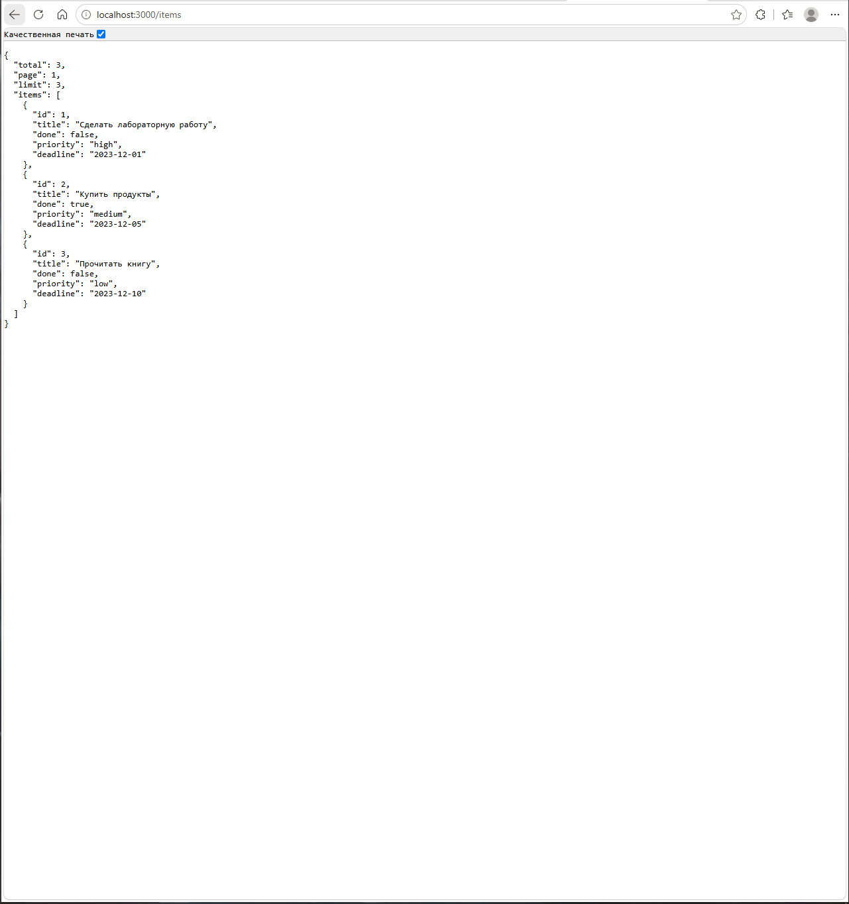
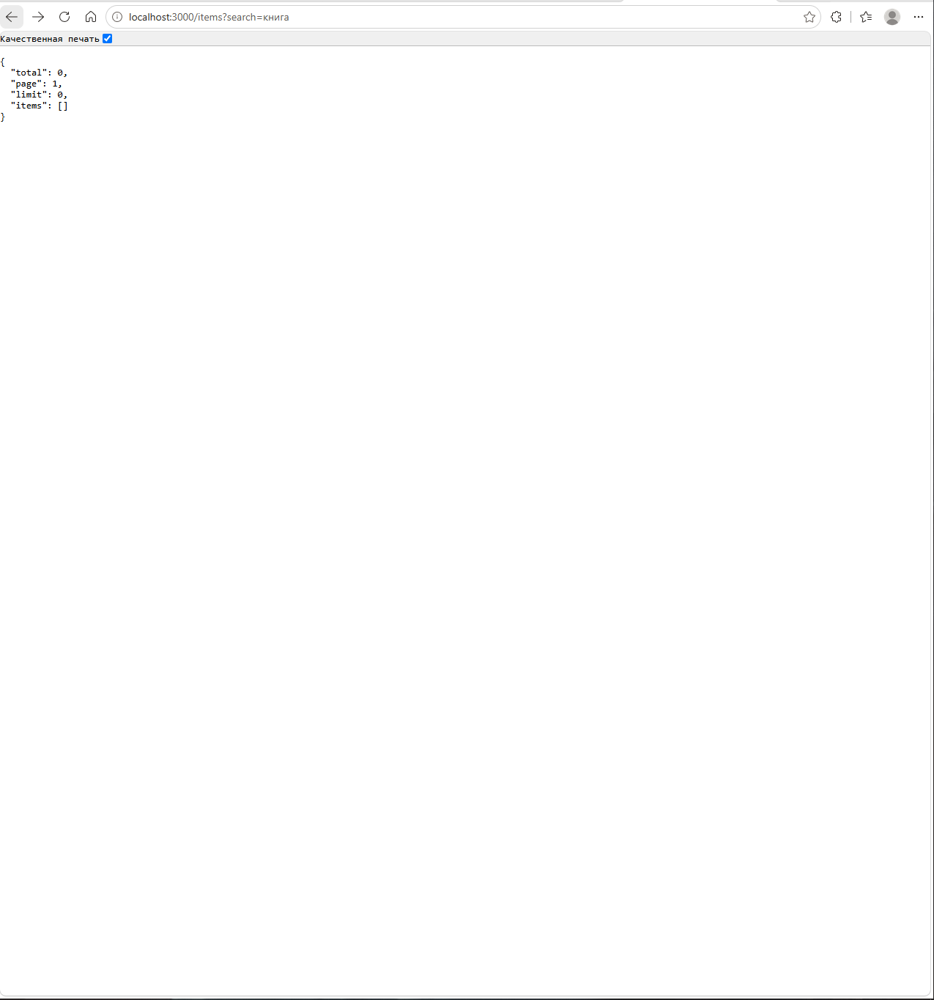
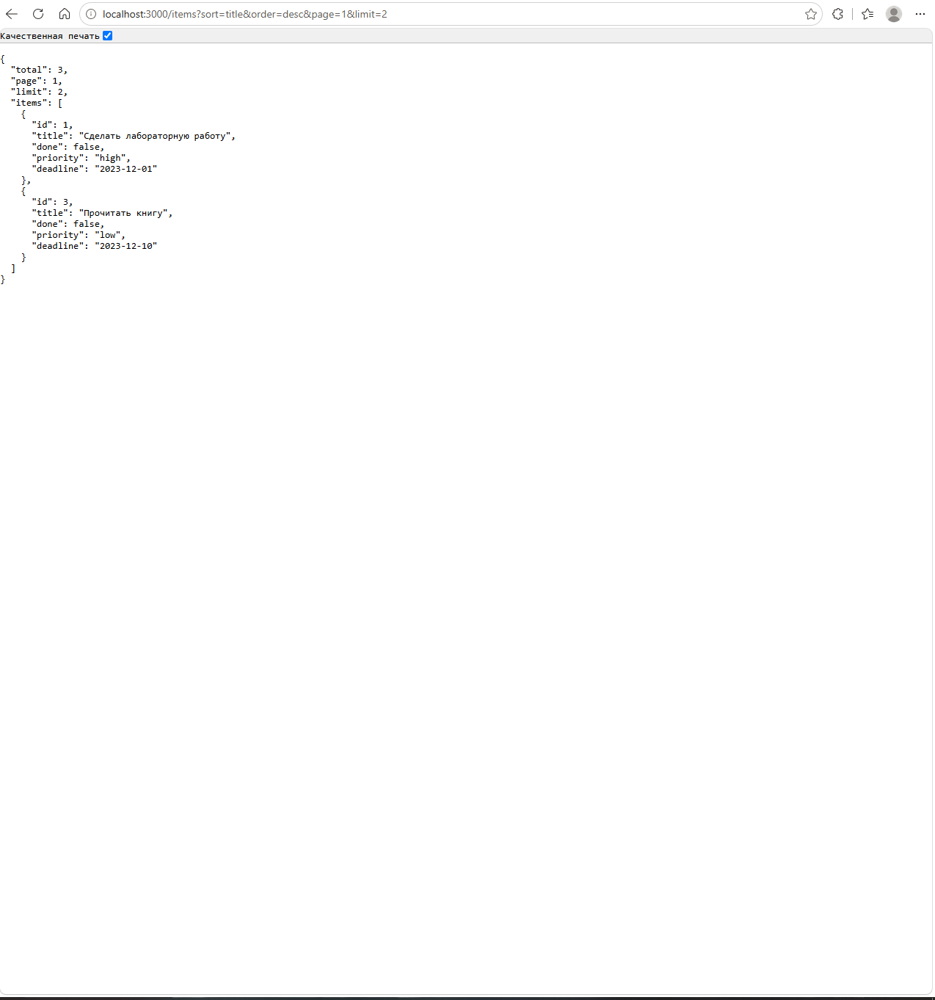
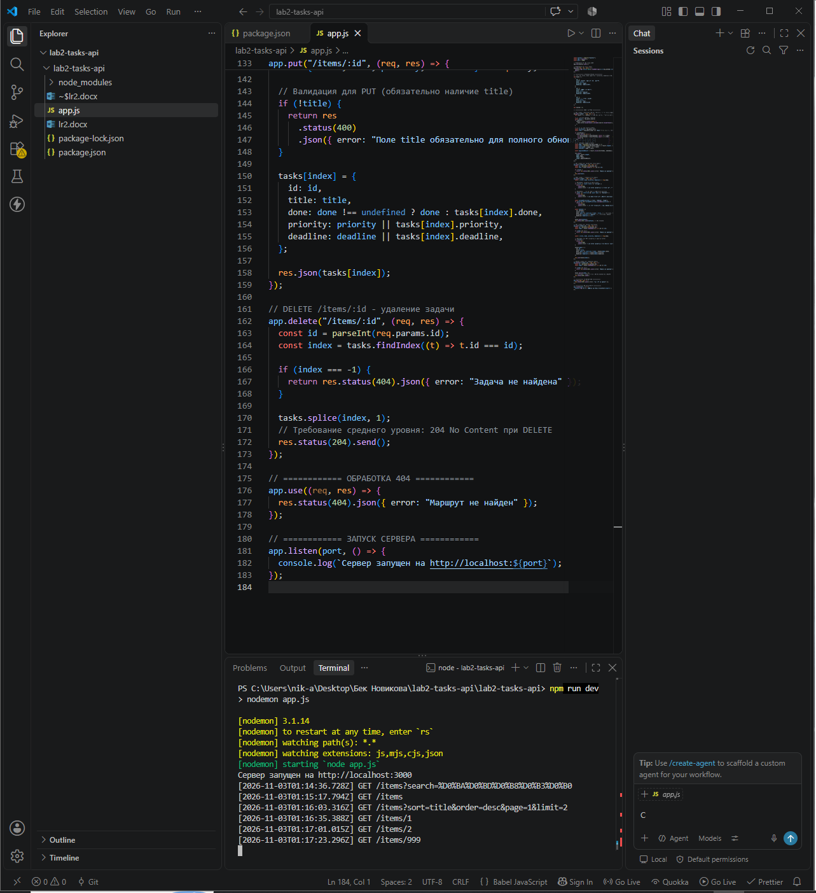

# Отчет по лабораторной работе №2

**Тема:** Изучение HTTP-методов и их применения для реализации CRUD-операций. Создание REST-подобного API с хранением данных в памяти сервера.

**Студент:** Авдеев Никита Викторович
**Группа:** ПИЖ-б-о-25-2
**Вариант:** Средний уровень, Вариант 1 
---

## Цель работы
Освоить обработку различных HTTP-методов (GET, POST, PUT, DELETE) в Express/Flask. Научиться реализовывать CRUD-операции над коллекцией объектов, хранящейся в памяти сервера, а также возвращать корректные HTTP-коды ответов (200, 201, 204, 400, 404).

## Теоретическое обоснование

**CRUD** — это акроним, обозначающий четыре базовые операции над данными:
*   **Create** (Создание) — метод `POST`.
*   **Read** (Чтение) — метод `GET`.
*   **Update** (Обновление) — методы `PUT` (полное) или `PATCH` (частичное).
*   **Delete** (Удаление) — метод `DELETE`.

**Основные HTTP-коды, используемые в работе:**
*   `200 OK` — успешный запрос (GET, PUT).
*   `201 Created` — ресурс успешно создан (POST).
*   `204 No Content` — успешное выполнение, но ответ не содержит тела (обычно DELETE).
*   `400 Bad Request` — ошибка в данных запроса (не пройдена валидация).
*   `404 Not Found` — ресурс не найден.

---

## Выполнение индивидуального задания (Вариант 1)
### Код сервера
```javascript
const express = require("express");
const app = express();
const port = 3000;

app.use(express.json());

app.use((req, res, next) => {
  console.log(`[${new Date().toISOString()}] ${req.method} ${req.url}`);
  next();
});

// ============ ХРАНИЛИЩЕ ДАННЫХ ============
// Поля: id, title, done (базовые) + priority, deadline (для среднего уровня)
let tasks = [
  {
    id: 1,
    title: "Сделать лабораторную работу",
    done: false,
    priority: "high",
    deadline: "2023-12-01",
  },
  {
    id: 2,
    title: "Купить продукты",
    done: true,
    priority: "medium",
    deadline: "2023-12-05",
  },
  {
    id: 3,
    title: "Прочитать книгу",
    done: false,
    priority: "low",
    deadline: "2023-12-10",
  },
];

let nextId = 4;

// ============ CRUD ОПЕРАЦИИ ============

// GET /items - получение списка с поиском, сортировкой и пагинацией
app.get("/items", (req, res) => {
  let result = [...tasks]; 

  // Поиск по названию (search)
  const search = req.query.search;
  if (search) {
    result = result.filter((task) =>
      task.title.toLowerCase().includes(search.toLowerCase()),
    );
  }

  // Сортировка (sort & order)
  const sortField = req.query.sort;
  const order = req.query.order === "desc" ? -1 : 1; // По умолчанию asc

  if (sortField) {
    result.sort((a, b) => {
      if (a[sortField] < b[sortField]) return -1 * order;
      if (a[sortField] > b[sortField]) return 1 * order;
      return 0;
    });
  }

  // Пагинация (page & limit)
  const page = parseInt(req.query.page) || 1;
  const limit = parseInt(req.query.limit) || result.length; // Если limit не указан - отдаем все
  const startIndex = (page - 1) * limit;
  const endIndex = page * limit;

  const paginatedResult = result.slice(startIndex, endIndex);

  res.json({
    total: result.length,
    page: page,
    limit: limit,
    items: paginatedResult,
  });
});

// GET /items/:id - получение одной задачи
app.get("/items/:id", (req, res) => {
  const id = parseInt(req.params.id);
  const task = tasks.find((t) => t.id === id);

  if (!task) {
    return res.status(404).json({ error: "Задача не найдена" });
  }
  res.json(task);
});

// POST /items - создание новой задачи
app.post("/items", (req, res) => {
  const { title, done, priority, deadline } = req.body;

  // ВАЛИДАЦИЯ: Обязательное поле title
  if (!title || typeof title !== "string") {
    return res
      .status(400)
      .json({ error: "Поле title обязательно и должно быть строкой" });
  }

  // ВАЛИДАЦИЯ: Проверка типов и допустимых значений
  if (done !== undefined && typeof done !== "boolean") {
    return res
      .status(400)
      .json({ error: "Поле done должно быть булевым значением (true/false)" });
  }

  const allowedPriorities = ["low", "medium", "high"];
  if (priority && !allowedPriorities.includes(priority)) {
    return res
      .status(400)
      .json({ error: "Приоритет должен быть: low, medium или high" });
  }

  const newTask = {
    id: nextId++,
    title: title,
    done: done !== undefined ? done : false, 
    priority: priority || "medium", 
    deadline: deadline || null,
  };

  tasks.push(newTask);
  res.status(201).json(newTask); // 201 Created
});

// PUT /items/:id - полное обновление
app.put("/items/:id", (req, res) => {
  const id = parseInt(req.params.id);
  const index = tasks.findIndex((t) => t.id === id);

  if (index === -1) {
    return res.status(404).json({ error: "Задача не найдена" });
  }

  const { title, done, priority, deadline } = req.body;

  // Валидация для PUT
  if (!title) {
    return res
      .status(400)
      .json({ error: "Поле title обязательно для полного обновления" });
  }

  tasks[index] = {
    id: id,
    title: title,
    done: done !== undefined ? done : tasks[index].done,
    priority: priority || tasks[index].priority,
    deadline: deadline || tasks[index].deadline,
  };

  res.json(tasks[index]);
});

// DELETE /items/:id - удаление задачи
app.delete("/items/:id", (req, res) => {
  const id = parseInt(req.params.id);
  const index = tasks.findIndex((t) => t.id === id);

  if (index === -1) {
    return res.status(404).json({ error: "Задача не найдена" });
  }

  tasks.splice(index, 1);
  // Требование среднего уровня: 204 No Content при DELETE
  res.status(204).send();
});

// ============ 404 ============
app.use((req, res) => {
  res.status(404).json({ error: "Маршрут не найден" });
});

// ============ ЗАПУСК СЕРВЕРА ============
app.listen(port, () => {
  console.log(`Сервер запущен на http://localhost:${port}`);
});

### Результаты работы индивидуального задания

**Корневой маршрут**


**GET /items (с поиском, сортировкой и пагинацией)**


**POST /items (с валидацией)**


**PUT /items/:id**


**DELETE /items/:id**


**Обработка 404**


**Логи запросов в терминале**


## Ответы на контрольные вопросы

**1. В чём разница между PUT и PATCH?
PUT используется для полного обновления ресурса (клиент должен передать все поля объекта, даже если они не меняются). PATCH используется для частичного обновления — передаются только те поля, которые нужно изменить, остальные остаются прежними.**

**2. Как реализовать поиск по коллекции (query-параметр search)?
Поиск реализуется в GET-запросе через объект req.query.search. Сервер фильтрует массив с помощью метода .filter(), проверяя, содержит ли нужное поле (например, title) искомую подстроку через метод .includes(). Для нечувствительности к регистру обе строки приводятся к нижнему регистру методом .toLowerCase().**

**3. Как реализовать сортировку по полю?
Сортировка выполняется методом .sort(). Название поля берется из req.query.sort, а направление — из req.query.order (asc или desc). В функции сравнения значения полей сравниваются через > и <. Если выбрана сортировка по убыванию, результат сравнения умножается на -1.**

**4. Как реализовать пагинацию (постраничный вывод)?
Нужно принять параметры page (номер страницы) и limit (элементов на странице). Вычисляется индекс первого элемента страницы: startIndex = (page - 1) * limit. Затем из общего массива отрезается нужный кусок с помощью метода .slice(startIndex, startIndex + limit).**

**5. Как валидировать входные данные (например, что price — число)?
Валидация проводится внутри POST/PUT обработчиков до сохранения. Проверяется наличие обязательных полей (if (!title)), тип данных (typeof price !== 'number') и допустимые значения (например, проверка по массиву ['low', 'high'].includes(priority)). Если проверка не пройдена, возвращается статус 400 Bad Request.**

**6. Какие коды ответов используются при ошибках валидации?
При ошибках валидации используется код 400 Bad Request. В теле ответа обычно передается JSON с описанием конкретной ошибки, например: {"error": "Поле title обязательно"}.**

**7. Как вернуть 204 No Content при DELETE?
В Express используется метод res.status(204).send(). Важно вызвать .send() без аргументов (или .end()), чтобы сервер не отправлял никакого тела ответа, как того требует стандарт HTTP для кода 204.**

**8. В чём разница между res.json() и res.send()?
Метод res.send() универсален: он может отправлять строки, буферы или HTML. Метод res.json() специально предназначен для отправки JSON: он автоматически приводит объект к строке (JSON.stringify) и устанавливает заголовок Content-Type: application/json.**

**9. Как избежать дублирования ID при создании новых элементов?
В данной работе используется глобальная переменная-счетчик let nextId = 4. При создании новой записи мы присваиваем ей id = nextId++, после чего счетчик увеличивается на 1. В реальных базах данных за это отвечают автоинкрементные поля или UUID.**

**10. Что такое express.json() и почему без него req.body пустой?
Это встроенный middleware (промежуточное ПО) Express. Он перехватывает входящий запрос, читает его тело и, если в заголовках указан тип application/json, парсит JSON-строку в JavaScript-объект, записывая результат в req.body. Без него Node.js не знает, как обрабатывать бинарный поток данных в теле запроса, и req.body остается пустым.**

## Вывод

В ходе лабораторной работы я освоил создание REST-подобного API на Node.js с использованием фреймворка Express. Я научился обрабатывать основные HTTP-методы (GET, POST, PUT, DELETE) и возвращать корректные статус-коды (200, 201, 204, 400, 404).

В рамках индивидуального задания я реализовал валидацию входящих данных, а также добавил функционал поиска, сортировки и пагинации с использованием query-параметров. Главными трудностями при выполнении стали вычисление индексов для пагинации и настройка корректного ответа при удалении (204 No Content), так как важно было не отправить тело ответа. Также я на практике убедился, что при хранении данных в памяти сервера они полностью теряются при его перезапуске, что подтверждает необходимость использования баз данных в реальных проектах.

## 7. Список использованных источников

1. Официальная документация Express.js. — Текст: электронный // Express: [сайт]. — URL: https://expressjs.com/ (дата обращения: 03.11.2026).
2. MDN Web Docs. HTTP методы и коды состояния. — Текст: электронный // MDN Web Docs: [сайт]. — URL: https://developer.mozilla.org/ru/docs/Web/HTTP (дата обращения: 03.11.2026).
3. Браун, И. Node.js и Express. Разработка веб-приложений / И. Браун. — Санкт-Петербург: Питер, 2022. — 320 с.
4. Официальная документация Nodemon. — Текст: электронный // npm: [сайт]. — URL: https://www.npmjs.com/package/nodemon (дата обращения: 03.11.2026).
5. Руководство по архитектуре REST API. — Текст: электронный // Habr: [сайт]. — URL: https://habr.com/ru/articles/483202/ (дата обращения: 03.11.2026).
6. Методические указания к лабораторной работе №2 «Изучение HTTP-методов и их применения для реализации CRUD-операций». — [Б. м.: б. и.], 2026. — 17 с.


## Ссылка на github:https://github.com/nikitaavdeev07-arch/lab2-tasks-api